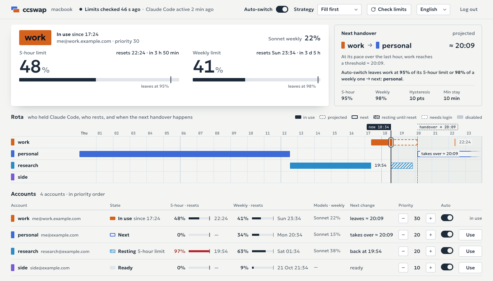

# ccswap

[English](README.md) · **Русский**

ccswap переключает Claude Code между вашими собственными подписками Claude: по команде или
автоматически, когда аккаунт в работе подходит к 5-часовому или недельному лимиту. Это не прокси.
ccswap подменяет вход, который Claude Code хранит на вашей машине. Запущенные сессии Claude Code
подхватывают новый вход примерно за полминуты без перезапуска, а немодифицированный Claude Code
остаётся единственной программой, которая отправляет вашу работу в Anthropic. Небольшой демон следит
за лимитами каждого аккаунта; управлять им можно из командной строки, терминального интерфейса или
локальной веб-страницы. Работает на macOS и Linux.

<picture>
  <source media="(prefers-color-scheme: dark)" srcset="docs/images/dashboard-dark.png">
  
</picture>

Установите ccswap, запустите фоновый демон с хуком Claude Code и добавьте аккаунт, в который Claude Code
вошёл сейчас (остальные добавляет `ccswap login <имя>`):

```sh
go install github.com/Dudude-bit/ccswap/cmd/ccswap@latest
ccswap daemon install
ccswap adopt work
```

> [!IMPORTANT]
> ccswap — неофициальный инструмент, он не связан с Anthropic и не одобрен ею. Используйте его только с
> аккаунтами, которыми владеете и за которые платите сами, и прочитайте
> [условия использования](#условия-использования), прежде чем добавлять аккаунт.

## Содержание

- [Условия использования](#условия-использования)
- [Как это работает](#как-это-работает)
- [Установка](#установка)
- [Первый запуск](#первый-запуск)
- [Команды](#команды)
- [Автопереключение](#автопереключение)
- [Веб-страница](#веб-страница)
- [TUI](#tui)
- [T3 Code](#t3-code)
- [Лимиты с другого ccswap](#лимиты-с-другого-ccswap)
- [Перенос аккаунта на другую машину](#перенос-аккаунта-на-другую-машину)
- [Linux-серверы](#linux-серверы)
- [Конфигурация](#конфигурация)
- [Языки](#языки)
- [Диагностика](#диагностика)
- [Безопасность](#безопасность)
- [Почему не прокси](#почему-не-прокси)
- [Похожие проекты](#похожие-проекты)
- [Участие и лицензия](#участие-и-лицензия)

## Условия использования

- **Неофициальный инструмент.** ccswap — независимый проект с открытым кодом. Anthropic его не
  создавала, не одобряла и не поддерживает. «Claude» и «Claude Code» — товарные знаки Anthropic.
- **Только свои аккаунты.** ccswap нужен, чтобы переключаться между подписками Claude, которыми вы
  владеете и за которые платите сами, на своих машинах. Никогда не добавляйте чужой аккаунт и не
  делитесь своим. [Потребительские условия](https://www.anthropic.com/legal/consumer-terms) Anthropic
  (действуют с 8 октября 2025 года), раздел 2: «You may not share your Account login information,
  Anthropic API key, or Account credentials with anyone else. You also may not make your Account
  available to anyone else.» (Нельзя передавать кому-либо данные для входа, API-ключ или учётные данные
  аккаунта и нельзя давать кому-либо доступ к аккаунту.) Планы Team и Enterprise подпадают под
  [коммерческие условия](https://www.anthropic.com/legal/commercial-terms).
- **Лимиты рассчитаны на обычное индивидуальное использование.** Страница Claude Code
  [«Legal and compliance»](https://code.claude.com/docs/en/legal-and-compliance#acceptable-use):
  «Advertised usage limits for Pro and Max plans assume ordinary, individual usage of Claude Code and
  the Agent SDK.» (Заявленные лимиты Pro и Max рассчитаны на обычное индивидуальное использование.)
  Переход на другую подписку, когда одна упёрлась в лимит, можно счесть выходом за эти рамки. Раздел 3
  потребительских условий также запрещает обращаться к сервисам «through automated or non-human means,
  whether through a bot, script, or otherwise» (автоматически: ботом, скриптом или иначе), кроме как по
  API-ключу или с явного разрешения Anthropic, и «bypassing any of our systems or protective measures»
  (обходить системы и защитные меры Anthropic). Текста Anthropic, который прямо разрешал бы или
  запрещал одному человеку держать несколько подписок, мы не нашли. Решайте сами, укладывается ли ваше
  использование в эти условия.
- **Что ccswap отправляет в Anthropic.** Ни промптов, ни запросов к моделям: ccswap ничего не
  проксирует. Его собственные запросы идут с user agent `ccswap/<версия>`:

  | Запрос | Зачем | Когда (по умолчанию) |
  |---|---|---|
  | `GET https://api.anthropic.com/api/oauth/usage` | 5-часовой, недельный и помодельные лимиты аккаунта | у включённых аккаунтов, не ждущих повторного входа: аккаунт в работе каждые 5 минут (`check_active`), остальные каждые 30 минут (`check_others`), все сразу по вашей просьбе, кроме спрошенных меньше минуты назад; после `429` ждёт `Retry-After` (до часа) и спрашивает реже |
  | `GET https://api.anthropic.com/api/oauth/profile` | почта входа, чтобы понять, чей это аккаунт | при добавлении аккаунта и когда у Claude Code вход, который ccswap ещё не опознал (например, после того как Claude Code его обновил); проверка раз в минуту |
  | `POST https://platform.claude.com/v1/oauth/token` | обновление входов аккаунтов, которыми Claude Code сейчас не пользуется, чтобы они оставались рабочими | когда до истечения токена доступа неактивного аккаунта меньше 10 минут и сразу после `ccswap migrate import`; вход, который держит Claude Code, — никогда |

  Обновление идёт с публичным идентификатором OAuth-клиента Claude Code: этому клиенту выдал входы
  `claude auth login`. Сам вход всегда проходит через `claude auth login` Claude Code: ваш пароль ccswap
  не видит.
- **Что ccswap спрашивает у GitHub.** Демон спрашивает новейший релиз у
  `GET https://api.github.com/repos/Dudude-bit/ccswap/releases/latest` через минуту после запуска и
  дальше каждые 12 часов, с user agent `ccswap/<версия>` и больше ничем; `[update] check = false` в
  `config.toml` это выключает. `ccswap update` и кнопка «Обновить» на странице тоже спрашивают его, а
  потом скачивают с github.com архив релиза и `checksums.txt`.
- **Токены остаются на этой машине.** Входы неактивных аккаунтов лежат в связке ключей macOS (service
  `ccswap`) или, на Linux, в файлах 0600 в папке ccswap. Кроме запросов к Anthropic из таблицы выше,
  машину они покидают, только когда вы переносите аккаунт командой `ccswap migrate`, в зашифрованном
  пакете. `ccswap remote` передаёт только цифры лимитов, токены — никогда. Телеметрии нет, авторам
  ничего не уходит.
- **Недокументированные интерфейсы.** Эндпоинты usage и profile, OAuth-клиент Claude Code и способ,
  которым Claude Code хранит вход, не являются публичными документированными интерфейсами. Любой из них
  может измениться без предупреждения и сломать ccswap.
- **Хранение и использование ваших OAuth-токенов.** В разделе
  [«Authentication and credential use»](https://code.claude.com/docs/en/legal-and-compliance#authentication-and-credential-use)
  той же страницы Claude Code сказано: «OAuth authentication is intended exclusively for purchasers of
  Claude Free, Pro, Max, Team, and Enterprise subscription plans and is designed to support ordinary use
  of Claude Code and other native Anthropic applications.» (OAuth-вход предназначен только для
  покупателей подписок и рассчитан на обычное использование Claude Code и других родных приложений
  Anthropic.) Там же: «developers may not collect, store, or intermediate Claude.ai credentials or
  session tokens — sign-in to a Claude account must complete through Anthropic's own flow»
  (разработчикам нельзя собирать, хранить учётные данные и сессионные токены Claude.ai или быть их
  посредником; вход в аккаунт Claude должен завершаться через собственный процесс Anthropic), и это не
  мешает «an end user from signing in to the unmodified Claude Code binary with their own Claude
  subscription» (пользователю входить в немодифицированный Claude Code со своей подпиской). Простыми
  словами: ccswap — программа, которую вы запускаете сами, на своей машине. Вход завершается через
  `claude auth login`, собственный процесс Anthropic. ccswap хранит и обновляет токены ваших собственных
  аккаунтов на этой машине и отправляет их только в Anthropic, в запросах из таблицы выше; авторы их
  никогда не получают. Но ccswap — не родное приложение Anthropic, и он сам пользуется этими токенами.
  Считается ли это «хранением учётных данных» по этим правилам, из текста Anthropic не следует. Это
  главный риск использования ccswap: решайте сами.
- **Риск для аккаунтов.** В том же разделе добавлено, что Anthropic «reserves the right to take
  measures to enforce these restrictions and may do so without prior notice» (оставляет за собой право
  принимать меры против нарушений этих ограничений без предупреждения). Anthropic может ограничить,
  заблокировать или закрыть аккаунты, которые сочтёт нарушающими условия. Вы используете ccswap на свой
  риск.
- **Без гарантий.** ccswap предоставляется «как есть», без каких-либо гарантий; см. [LICENSE](LICENSE).

## Как это работает

- Claude Code хранит вход в одном месте: в записи связки ключей на macOS, в
  `~/.claude/.credentials.json` на Linux, плюс сведения об аккаунте в `oauthAccount` в `~/.claude.json`.
  Входы остальных ваших аккаунтов ccswap держит в собственном хранилище.
- Чтобы переключить аккаунт, ccswap сохраняет текущий вход в хранилище и записывает на его место вход
  целевого аккаунта, держа те же каталоги-блокировки, что Claude Code использует для своих записей, а
  затем обновляет `oauthAccount`. Всё остальное в записи, например входы MCP-серверов, не трогается.
- Запущенные сессии Claude Code перечитывают вход примерно за полминуту. Ничего не перезапускается.
- Демон проверяет лимиты каждого аккаунта и переключает, когда аккаунт в работе доходит до порога. Хук
  `StopFailure` в настройках Claude Code сразу сообщает ему, если сессия остановилась на лимите.
- ccswap никогда не обновляет вход, которым пользуется Claude Code: токен обновления одноразовый, и
  такое обновление разлогинило бы Claude Code.

Подробности — файлы, блокировки, опознание входа, опрос лимитов и API демона — в
[docs/how-it-works.md](docs/how-it-works.md) (на английском).

## Установка

Нужны macOS или Linux (amd64 или arm64) и Claude Code, причём `claude` должен быть в `PATH`.
На Linux демон работает как пользовательская служба systemd или под супервизором по вашему выбору.

**Через Go** (1.21 или новее; нужную ccswap версию Go команда `go` скачает сама):

```sh
go install github.com/Dudude-bit/ccswap/cmd/ccswap@latest
```

Бинарник попадёт в `$(go env GOPATH)/bin`, обычно `~/go/bin`; эта папка должна быть в `PATH`.

**Из релиза.** В каждом [релизе](https://github.com/Dudude-bit/ccswap/releases) есть архив под каждую
платформу (`darwin_arm64`, `darwin_amd64`, `linux_amd64`, `linux_arm64`) и `checksums.txt`. Задайте в `V`
нужный релиз без `v`, а в `A` свою платформу. На Linux без `shasum` пишите `sha256sum` вместо
`shasum -a 256`. Если контрольная сумма не сошлась, ничего не распакуется и не установится:

```sh
V=1.2.3
A=darwin_arm64
curl -fLO "https://github.com/Dudude-bit/ccswap/releases/download/v$V/ccswap_${V}_$A.tar.gz"
curl -fLO "https://github.com/Dudude-bit/ccswap/releases/download/v$V/checksums.txt"
shasum -a 256 -c --ignore-missing checksums.txt &&
  tar xzf "ccswap_${V}_$A.tar.gz" ccswap &&
  mkdir -p ~/.local/bin && install -m 0755 ccswap ~/.local/bin/ccswap
```

`~/.local/bin` должен быть в `PATH` (`export PATH="$HOME/.local/bin:$PATH"` в `~/.zshrc`). Бинарники не
нотаризованы: если архив скачан браузером, macOS может отказаться запускать ccswap, пока вы не снимете
карантин командой `xattr -d com.apple.quarantine ~/.local/bin/ccswap`. Скачанное через `curl` в карантин
не попадает.

**Из исходников.** `make install` собирает `bin/ccswap` и ставит его в `~/.local/bin` (в
`<префикс>/bin` с `make install PREFIX=<префикс>`):

```sh
git clone https://github.com/Dudude-bit/ccswap.git
cd ccswap
make install
```

**Обновление.** `ccswap update` ставит новейший релиз поверх того ccswap, которым вы его запустили:
скачивает архив для вашей платформы, сверяет его с `checksums.txt` релиза, проверяет, что новый бинарник
здесь запускается и называет версию релиза, и ставит его на место одним переименованием. Демон, который
работает на этом же файле, затем перезапускается на нём в своём же процессе, как после кнопки «Обновить»
на странице; служба с её настройками прокси и локали и хук остаются как были. Демон, который работает на
другом ccswap, не трогается, а `ccswap update` называет бинарник, который нужно обновить вместо этого.
`ccswap update --check` только говорит, вышел ли релиз новее. Демон проверяет это и сам (см.
[Что ccswap спрашивает у GitHub](#условия-использования)): тогда об этом говорят `ccswap status` и
веб-страница, а на странице есть кнопка «Обновить». Сборку без версии, например `make install` из
клона без тегов, с релизами не сравнить: обновляйте её так же, как собирали.

Чтобы обновить вручную, поставьте новый бинарник тем же способом, что и раньше, и снова выполните
`ccswap daemon install`: демон перезапустится на новом бинарнике, а служба и хук будут указывать на него.
Заменяйте файл (`install`, `make install`), а не копируйте поверх: macOS убивает процесс, чей бинарник
переписали на месте. `ccswap doctor` покажет, если что-то ещё указывает на старый путь. Уже запущенные
сессии Claude Code сохраняют хук, с которым стартовали, пока вы их не перезапустите.

**Удаление.** Сначала переключите Claude Code на аккаунт, который хотите оставить: остальные входы
хранятся только в хранилище ccswap. Затем `ccswap daemon uninstall` уберёт службу и хук; удалите
бинарник и папку ccswap (`~/Library/Application Support/ccswap` на macOS, `~/.config/ccswap` на Linux).
На macOS хранилище лежит в связке ключей: удалите записи с service `ccswap` в «Связке ключей».

## Первый запуск

Поставьте службу демона и хук `StopFailure`, выключите автопереключение, пока добавляете аккаунты,
добавьте аккаунт, в который Claude Code вошёл сейчас, войдите в остальные и снова включите
автопереключение:

```sh
ccswap daemon install
ccswap auto off
ccswap adopt work --priority 30
ccswap login personal --priority 20
ccswap login side --priority 10
ccswap list
ccswap auto on
```

- Claude Code читает хуки при старте сессии: сессии, запущенные до `ccswap daemon install`, получат хук
  после перезапуска. До тех пор ccswap всё равно видит их лимиты через опрос.
- `adopt` добавляет вход, который уже есть у Claude Code. `login` запускает `claude auth login` во
  временной папке и сохраняет результат, не трогая вход, которым пользуется Claude Code.
- `login` печатает ссылку. Откройте её в браузере, где вы вошли в нужный аккаунт Claude, или в
  приватном окне, или на другом своём устройстве, например на телефоне. Затем вставьте в строку
  `Paste code here` то, что покажет страница: код `CODE#STATE` или целиком адрес страницы, где он показан.
  Код подходит только к ссылке, которую напечатал этот запуск.
- Имя состоит из строчных латинских букв, цифр и дефисов, начинается с буквы или цифры, не длиннее 32
  знаков.
- Аккаунт с большим приоритетом используется раньше; по умолчанию приоритет 0. Поменять:
  `ccswap priority <имя> <N>`, `+` и `-` в TUI или на веб-странице.
- Автопереключение включено с самого начала. Выключите его, пока добавляете аккаунты, иначе ccswap может
  перейти на аккаунт с большим приоритетом, как только вы его добавите.
- Если ccswap пишет `Нужно войти заново: ccswap login <имя>`, выполните ровно это: вход в ту же почту
  заменит сохранённый. Для аккаунта в работе войдите заново внутри Claude Code (`/login`); ccswap
  подхватит новый вход сам.

## Команды

| Команда | Что делает |
|---|---|
| `ccswap login <имя> [--priority N]` | Войти в аккаунт Claude через `claude auth login` и добавить его или заново войти в уже добавленный |
| `ccswap adopt <имя> [--priority N]` | Добавить аккаунт, в который Claude Code вошёл сейчас |
| `ccswap remove <имя> [--yes]` | Удалить аккаунт и его сохранённый вход (кроме аккаунта в работе) |
| `ccswap use <имя> [--force]` | Сразу переключить Claude Code на аккаунт |
| `ccswap list [--json]` (псевдоним `ls`) | Аккаунты, их лимиты и сбросы |
| `ccswap status` | Аккаунт в работе, автопереключение, пороги, где лежит вход Claude Code, последняя проверка |
| `ccswap priority <имя> <N>` | Задать приоритет аккаунта |
| `ccswap enable <имя>` / `disable <имя>` | Вернуть аккаунт в автопереключение или исключить из него |
| `ccswap auto on\|off` | Включить или выключить автопереключение |
| `ccswap strategy [fill-first\|cache-aware]` | Показать или задать порядок автоматических переключений |
| `ccswap lang [<tag>\|auto]` | Показать язык и доступные языки, закрепить язык или снова брать его из локали |
| `ccswap web` | Открыть веб-страницу с одноразовым кодом настроек (на Linux — напечатать ссылку) |
| `ccswap tui` | Интерактивный экран аккаунтов |
| `ccswap t3` | Адрес и ключ чтения слушателя: для T3 Code, входа на страницу только для просмотра и `remote set` |
| `ccswap remote` | Показать, откуда берутся лимиты: с другого ccswap или от Anthropic |
| `ccswap remote set <url>` | Брать лимиты у ccswap по адресу url; спросит его ключ чтения |
| `ccswap remote off` | Снова спрашивать лимиты у Anthropic |
| `ccswap migrate export <имя>... [-o файл] [--yes]` | Упаковать аккаунты в зашифрованный пакет и удалить их здесь |
| `ccswap migrate import [файл] [--code КОД] [--replace]` | Добавить аккаунты из пакета: из файла, stdin или вставкой |
| `ccswap update [--check]` | Поставить новейший релиз и перезапустить на нём демон или только сказать, вышел ли он |
| `ccswap doctor` | Проверить окружение; код выхода 1, если какая-то проверка не прошла |
| `ccswap daemon install` / `uninstall` | Поставить (или переставить с перезапуском) службу демона и хук либо убрать их |
| `ccswap daemon run` | Запустить демон в этом терминале |
| `ccswap daemon status` | Состояние службы, демона и хука |
| `ccswap signal` | Команда хука: читает событие Claude Code из stdin |
| `ccswap completion <оболочка>` | Скрипт автодополнения для bash, zsh, fish или powershell |

`ccswap use` отказывается переключать, пока до собственного обновления токена Claude Code осталось
несколько минут (иначе у ccswap может остаться копия старого входа, которую это обновление только что
израсходовало), и пока ccswap не может понять, в какой аккаунт вошёл Claude Code. Повторите через
минуту. `--force` переключает всё равно, полагаясь на последнюю запись ccswap об аккаунте в работе;
используйте его, только если точно знаете, что Claude Code простаивает. ccswap никогда не затирает вход,
копии которого у него нет: если Claude Code вошёл в аккаунт, которого ccswap не знает, сначала добавьте
его командой `ccswap adopt <имя>`.

## Автопереключение

**Когда ccswap уходит с аккаунта.** Когда аккаунт в работе доходит до порога:

- 95% 5-часового окна (`five_hour`),
- 98% недельного окна или помодельного недельного окна, например Sonnet (`weekly`),
- или когда сессия остановилась на лимите: об этом сообщает хук, и аккаунт час считается упёршимся в
  лимит, или до сброса окна, которое названо в сообщении, если он раньше (если окно не названо, то до
  ближайшего сброса окна на 80% и выше). Исключение: свежие цифры показывают этот лимит ниже 80% (тогда
  сессия работала на другом аккаунте) или его сброс после проверки (тогда сообщение пришло из-за старого окна).

**Куда.** На первый пригодный аккаунт по порядку: включённый, не ждущий повторного входа, с достаточно
свежими цифрами и ниже своих порогов. Сначала больший приоритет; внутри приоритета решает
[стратегия](#стратегии). TUI и страница помечают этот аккаунт как «Следующий».

**Когда возвращается.** На аккаунт с большим приоритетом ccswap возвращается, когда каждое его окно
опустится на `hysteresis` (10) пунктов ниже порога, например ниже 85% 5-часового окна.

**Прочие правила.**

- Между автоматическими переключениями проходит не меньше `min_dwell` (10 минут), если только аккаунт в
  работе не исчерпан.
- Ручной `ccswap use` при включённом автопереключении держится только `min_dwell`: потом ccswap может
  вернуться на свободный аккаунт с большим приоритетом. Чтобы закрепить выбор, выполните
  `ccswap auto off`.
- Аккаунт, выключенный командой `disable`, автоматически не выбирается. Вручную через `use` — можно,
  но при включённом автопереключении ccswap уйдёт с него на следующем тике (на другой включённый
  аккаунт, если такой есть), поэтому сначала выполните `ccswap auto off`.
- Хук не учитывает сессии, которые не пользуются входом, переключаемым ccswap: запущенные с
  `CLAUDE_CODE_OAUTH_TOKEN`, `ANTHROPIC_API_KEY`, `ANTHROPIC_AUTH_TOKEN` или `ANTHROPIC_BASE_URL` либо с
  `CLAUDE_CONFIG_DIR`, отличным от того, что у ccswap.
- Когда все аккаунты упёрлись в лимит, ccswap остаётся на месте или переходит на аккаунт, который
  освободится первым, и сообщает, когда это случится.
- Если Claude Code давно не запускался, его токен истёк, и ccswap не переключает с него, пока Claude Code
  сам не обновит токен: отправьте любое сообщение в `claude`.
- Уведомления: на macOS — системное уведомление о каждом переключении, о входе, который нужно обновить,
  и о том, что все аккаунты упёрлись в лимит; на Linux те же строки пишутся только в `daemon.log`.

### Стратегии

Обе стратегии ставят больший приоритет первым. Различаются они внутри приоритета:

- `fill-first` (по умолчанию): аккаунт, у которого больше всего запаса. Возврат на больший приоритет —
  как только тот восстановится и пройдёт `min_dwell`.
- `cache-aware`: возврат на больший приоритет — как только тот восстановится, как в `fill-first`. Внутри
  приоритета — аккаунт, чей недельный запас (неделя и помодельные недели) сбрасывается раньше всех, чтобы
  запас, который вот-вот сгорит, был потрачен; 5-часовое окно учитывается только как исчерпание. После
  переключения каждая запущенная сессия заново строит кэш промптов на новом аккаунте, а это тоже тратит
  лимит. Поэтому, пока кэш тёплый, `cache-aware` переходит внутри приоритета только ради запаса, который
  сбросится в течение суток и хотя бы на час раньше, чем у текущего аккаунта. Когда Claude Code простоял
  час, кэш всё равно истёк, и переход свободен.

Чтобы аккаунты тратились по порядку их сбросов, дайте им одинаковый приоритет. Когда Claude Code в
последний раз делал запрос, `cache-aware` узнаёт по самой свежей записи в его транскриптах
(`~/.claude/projects/**/*.jsonl`); если прочитать их не удалось, кэш считается тёплым. `fill-first` их не
читает. Стратегию задают командой `ccswap strategy cache-aware`, клавишей `s` в TUI или на странице; она
хранится в `state.json`.

### Как часто проверяются лимиты

- Демон тикает каждые `poll_interval` (60 с): следит за входом Claude Code, обновляет токены неактивных
  аккаунтов и решает о переключениях по тем цифрам, что у него есть.
- У Anthropic лимиты аккаунта спрашиваются раз в `check_active` (5 минут) для аккаунта в работе и раз в
  `check_others` (30 минут) для остальных: их цифры меняются, только если ими пользуются где-то ещё.
  Про выключенные аккаунты и аккаунты, ждущие повторного входа, ccswap не спрашивает никогда.
- «Проверить лимиты» на странице, `r` в TUI и `POST /v1/refresh` спрашивают все аккаунты сразу, кроме
  тех, которым Anthropic велела подождать или которые спрашивали меньше минуты назад.
- После `429` ccswap выжидает `Retry-After` (до часа) и спрашивает этот аккаунт с удвоенным интервалом,
  но не больше 10 минут (более длинный интервал остаётся как есть); после 30 ответов подряд темп
  постепенно возвращается.
- Цифры аккаунта считаются действительными примерно два его интервала, дольше — пока `429` не даёт
  спросить (не больше чем на час сверх того). На аккаунт с более старыми цифрами ccswap не переключает.

## Веб-страница

`ccswap web` открывает страницу в браузере; на Linux печатает ссылку. На странице видны лимиты и сбросы
каждого аккаунта и график смен за последние сутки и ближайшие часы: кто и когда держал Claude Code,
аккаунт в работе и момент, когда он при темпе последнего часа должен дойти до порога. Аккаунт, на
который тогда перейдёт автопереключение, помечен как «Следующий» и выбран по тому же правилу, что и само
переключение. Со страницы можно менять приоритеты, набор аккаунтов для автопереключения, само
автопереключение, стратегию, пороги и интервалы проверок (они пишутся в `config.toml`, комментарии в
котором не сохраняются, и действуют со следующей проверки). Можно и переключить аккаунт. Изменения
приходят сразу (server-sent events из `GET /v1/events`).

Когда выходит релиз ccswap новее, страница говорит об этом и даёт ссылку на то, что нового. С ключом
администратора кнопка «Обновить» ставит его так же, как `ccswap update`: демон заменяет свой бинарник,
запускается на нём заново в том же процессе, а страница перезагружается, когда демон вернётся. Служба и
хук продолжают указывать на тот же файл. Страница, которая только смотрит, вместо кнопки показывает
команду.

При запуске демон переписывает описание своей службы (LaunchAgent или юнит systemd), если она запускает
бинарник этого демона, а обновление изменило то, что пишет `ccswap daemon install`. Бинарник, лог и
переменные окружения из файла остаются, так что прокси и локаль сохраняются, и ничего не перезапускается:
launchd прочитает новое описание при следующем входе в систему или `ccswap daemon install`, systemd (после
`daemon-reload`, который выполняет демон) — при следующем запуске службы.

Страницу отдаёт TCP-слушатель демона по адресу `http://127.0.0.1:8318/management.html` (`/`
перенаправляет туда); `[t3] enabled = false` выключает её. Её защищают два ключа:

- **Ключ чтения** — тот, что печатает `ccswap t3`. С ним страница только показывает. «Запомнить ключ на
  этом устройстве» сохраняет его и после закрытия вкладки.
- **Ключ администратора** меняет настройки. Он никогда не печатается и не попадает в ссылку: `ccswap web`
  просит у демона одноразовый код (на один раз, действует минуту) и открывает
  `…/management.html#code=…`. Страница меняет код на ключ администратора, убирает код из адресной строки
  и хранит ключ в `sessionStorage` вкладки, так что он исчезает вместе с вкладкой. Для новой вкладки
  снова выполните `ccswap web`.

Настройки меняются только через слушатель на loopback-адресе (по умолчанию так и есть) и только на
странице, открытой по loopback-имени (`127.0.0.1`, `localhost` или `[::1]`). Чтобы смотреть страницу с
телефона или другого компьютера, слушайте на всех интерфейсах и выполните `ccswap daemon install` и
`ccswap web`, который тогда напечатает ссылку на каждый адрес; такой слушатель только показывает, даже с
ключом администратора:

```toml
[t3]
listen = "0.0.0.0:8318"
```

Слушатель говорит по обычному HTTP. Вне сети, которой вы доверяете, держите его на loopback и
пользуйтесь SSH-туннелем: `ssh -L 8318:127.0.0.1:8318 server`, затем выполните `ccswap web` на сервере и
откройте его ссылку у себя в течение минуты.

Каждый ccswap переключает только Claude Code на своём компьютере, и его страница называет этот
компьютер. Принудительное переключение, добавление, вход и удаление аккаунтов остаются в терминале.
Страница говорит на всех языках ccswap: начинает с языка браузера (если у ccswap такого нет — с
английского), а меню языка запоминает выбор на этом устройстве.

## TUI

`ccswap tui` показывает аккаунты и их лимиты в терминале:

| Клавиша | Действие |
|---|---|
| `↑` `k` / `↓` `j` | выбрать аккаунт |
| `enter` | переключиться на него (спросит `y`/`n`, если токен Claude Code вот-вот обновится) |
| `space` | включить в автопереключение или исключить из него |
| `+` `=` / `-` `_` | приоритет на 10 выше или ниже |
| `a` | автопереключение вкл/выкл |
| `s` | стратегия: fill-first или cache-aware |
| `r` | проверить лимиты всех аккаунтов сейчас |
| `l` | войти в новый аккаунт (спросит имя) |
| `?` | справка |
| `q`, `ctrl+c` | выход |

## T3 Code

[T3 Code](https://github.com/pingdotgg/t3code) умеет показывать лимиты аккаунтов из «usage hub» —
API управления [CLIProxyAPI](https://github.com/router-for-me/CLIProxyAPI). Слушатель ccswap отвечает
на ту часть этого API, которую читает T3 Code, так что T3 Code показывает ваши аккаунты и их лимиты:

1. Выполните `ccswap t3`. Команда напечатает адрес (по умолчанию `http://127.0.0.1:8318`; если слушатель
   на всех интерфейсах, по адресу на каждый) и ключ чтения.
2. В T3 Code: Settings → Providers → Usage providers → Add hub.

На запросы T3 Code ccswap отвечает тем, что уже знает, и спрашивает Anthropic только про включённые
аккаунты, не ждущие повторного входа, чей интервал проверки это позволяет. Ключ только читает. Если
T3 Code запущен на сервере, добавьте hub там, с `ccswap t3` этого сервера. Сессии Claude Code, которые
запускает T3 Code, следуют за ccswap как любые другие, если только в их окружении не задан
`CLAUDE_CODE_OAUTH_TOKEN`.

## Лимиты с другого ccswap

Anthropic ограничивает частоту запросов к эндпоинту usage для каждого аккаунта, и учитывается каждая
машина, которая спрашивает. Когда ccswap с одними и теми же аккаунтами работает на двух ваших машинах,
пусть Anthropic спрашивает одна, а вторая берёт цифры у неё:

```sh
ccswap remote set https://ccswap.example.com
```

Команда спросит ключ чтения того ccswap: его печатает `ccswap t3` там. `ccswap remote` показывает,
откуда сейчас берутся лимиты, а `ccswap remote off` возвращает запросы к Anthropic.

- Другой ccswap должен быть доступен: укажите в его `[t3] listen` адрес, до которого дотягивается эта
  машина (адрес в локальной сети или Tailscale), или поставьте перед ним https-прокси.
- Адрес должен быть https либо обычным http до `localhost` или loopback-, частного или CGNAT-адреса
  (Tailscale), потому что ключ уходит с каждым запросом. Пользователя и пароля в адресе быть не может.
  Ключ хранится в хранилище, адрес — в `[remote] url`.
- За тик цифры всех аккаунтов берутся одним запросом, аккаунты сопоставляются по почте. У Anthropic
  напрямую спрашиваются: аккаунт, которого у другого ccswap нет; аккаунт в работе, если его цифры там
  старше `check_active` плюс тик; любой другой, если они старше двух `check_others`; и все, пока другой
  ccswap не отвечает. «Проверить лимиты» тоже спрашивает Anthropic напрямую.
- Передаются только цифры лимитов, токены — никогда. T3 Code на этой машине тоже видит цифры другого
  ccswap.

## Перенос аккаунта на другую машину

`ccswap migrate` переносит аккаунты вместе со входом на другую свою машину (новый Mac, сервер, машина,
где неудобно входить через браузер) в зашифрованном пакете. Это перенос, а не копия: токен обновления
одноразовый, и один вход на двух машинах выбьет одну из них при первом же обновлении. Аккаунт в работе в
Claude Code и аккаунт, которому нужен новый вход, перенести нельзя.

**Через файл (рекомендуется):**

```sh
ccswap migrate export work -o work.ccswap
scp work.ccswap server:
ssh -t server ccswap migrate import work.ccswap
```

Экспорт удаляет `work` здесь, когда файл записан, и печатает код. Импорт спрашивает код, добавляет `work`
и удаляет файл.

**Вставкой:** `ccswap migrate export work` печатает пакет. Выполните `ccswap migrate import` на другой
машине, вставьте пакет от строки BEGIN до строки END и введите код. Аккаунты удаляются здесь до того, как
пакет напечатан, поэтому скопируйте его, прежде чем закрыть терминал.

**Через конвейер:** `ccswap migrate export work | ssh server ccswap migrate import`. Аккаунты
удаляются здесь до отправки пакета, а конвейер не может сказать, дошёл ли тот. Пакет, который конвейер
не принял, сохраняется здесь, в `migrate/` в папке ccswap. Пакет, который дошёл, но не импортировался
(нет терминала, чтобы спросить код, трижды неверный код, демон не запущен, аккаунт там уже есть, пакет
от более новой версии ccswap), сохраняется там, на другой машине, вместе с командой, завершающей перенос.
Вход теряется, только если пакет ушёл в конвейер и не вышел из него; двух копий не бывает никогда.
Обычный `ssh` не даёт импорту терминала, поэтому напечатанную им команду выполните через `ssh -t`. Если
запускать с целевой машины, терминал у импорта есть:
`ssh old-mac ccswap migrate export work --yes | ccswap migrate import`. Текст вокруг пакета, например
приветствие при входе по SSH, игнорируется.

Что важно знать:

- **Код.** Экспорт показывает одноразовый код один раз. Его нет ни в пакете, ни в логе, и без него пакет
  бесполезен. Импорт спрашивает код без эха, всего три попытки. `--code КОД` передаёт его в командной
  строке, но тогда он попадёт в историю оболочки и список процессов.
- **Импортируйте пакет один раз.** Импорт сразу обновляет вход и тем самым тратит токен обновления из
  пакета: повторный импорт в другом месте получит мёртвый вход. Файл пакета после импорта удаляется.
- **Заморозка.** С момента упаковки и до удаления аккаунты заморожены: ccswap не обновляет их и не
  переключается на них. Если экспорт не завершился за 5 минут или демон перезапустился, экспорт
  отменяется и аккаунты остаются.
- **Прерванный импорт.** Если импорт не знает, прошёл ли он (демон не ответил вовремя), он говорит об
  этом и сохраняет пакет. Через минуту выполните `ccswap list`: если в списке есть перенесённые аккаунты,
  импорт прошёл — удалите пакет и больше его не импортируйте; если нет — импортируйте.
- **Прерванный экспорт.** Если экспорт не знает, прошёл ли он, он сохраняет пакет (файл `-o` или копию
  в `migrate/`) и называет время. После него выполните `ccswap list`: если аккаунты всё ещё в списке, они
  остались здесь — удалите пакет; если нет, пакет — единственная копия их входов, импортируйте его на
  другой машине. Если экспорт убили, прежде чем он что-нибудь сказал, подождите пять минут до конца
  заморозки и проверьте так же.
- **`--replace`.** Импорт отказывается добавлять аккаунт, чья почта здесь уже есть. С `--replace`
  здешний аккаунт получает вход, имя, приоритет и включённость из пакета. Аккаунт в работе он не заменяет
  никогда, как и имя, за которым здесь другая почта. Сначала он обновляет вход из пакета, так что рабочий
  вход здесь заменяется только рабочим: если пакет уже импортировали или обновление не удалось, здешний
  аккаунт остаётся как был. Для `--replace` нужен доступ к Anthropic.

Это первое обновление тратит копию входа из пакета. Если импорт затем сорвётся по другой причине,
здешний аккаунт получит обновлённый вход, и повторный импорт продолжит с этого места. После перезапуска
демона такой повтор отклоняется как уже использованный. Сохраните пакет: в нём могут быть единственные
входы остальных его аккаунтов, и завершите перенос, переместив аккаунт с обновлённым входом (скажем,
`work`) наружу и обратно вокруг импорта:

```sh
ccswap migrate export work -o work.ccswap
ccswap migrate import moved.ccswap --replace
ccswap migrate import work.ccswap --replace
```

Экспорт сохраняет рабочий вход `work` в отдельный пакет. Импорт сохранённого пакета (`moved.ccswap`)
приносит остальные его аккаунты рабочими, а `work` — с мёртвым входом, и импорт `work.ccswap` возвращает
`work` его рабочий вход.

## Linux-серверы

На Linux-сервере ccswap работает так же. Вход Claude Code там — файл `~/.claude/.credentials.json`, а
хранилище ccswap — файлы 0600 в `~/.config/ccswap/vault/`. Уведомлений нет (о переключениях пишет
`daemon.log`), а `ccswap web` печатает ссылки, а не открывает браузер.

**Установка.** Поставьте ccswap на сервере из архива релиза или через `go install`, либо соберите на
другой машине и скопируйте бинарник (для arm64-сервера — `GOARCH=arm64`):

```sh
GOOS=linux GOARCH=amd64 make build
scp bin/ccswap server:/tmp/ccswap
ssh server 'install -D -m 0755 /tmp/ccswap ~/.local/bin/ccswap && ~/.local/bin/ccswap daemon install'
```

Обновляйте командой `ccswap update` на сервере или тем же способом: поверх бинарника работающего демона
`scp` писать не может (`Text file busy`), а `install` заменяет файл.

**Демон.** `ccswap daemon install` пишет пользовательский юнит `~/.config/systemd/user/ccswap.service`,
включает и перезапускает его, ставит хук и включает linger, чтобы демон продолжал работать после выхода
из SSH. Если это не удалось, он скажет об этом и напечатает команду:
`sudo loginctl enable-linger <пользователь>`. Без пользовательской сессии systemd (контейнер, «голый»
вход по SSH) он предложит запускать `ccswap daemon run` под tmux или своим супервизором и не оставит
файла юнита.

**Вход по SSH.** `ccswap login <имя>` печатает ссылку: откройте её в любом браузере, хоть на телефоне,
войдите и вставьте код в строку `Paste code here`.

**У каждой машины свои входы.** Не копируйте вход или папку ccswap: токен обновления одноразовый, и
копия, использованная на другой машине, выбьет оригинал. Выполните на сервере `ccswap login` или
`ccswap adopt` либо [перенесите аккаунт](#перенос-аккаунта-на-другую-машину). Если те же аккаунты есть
и на маке, пусть Anthropic спрашивает один ccswap, а второй [берёт цифры у него](#лимиты-с-другого-ccswap).

## Конфигурация

`config.toml` лежит в папке ccswap: `~/Library/Application Support/ccswap/` на macOS,
`~/.config/ccswap/` на Linux (`$XDG_CONFIG_HOME/ccswap`); переменная `CCSWAP_HOME` переносит папку. Все
ключи необязательны, неизвестный ключ — ошибка. Значения по умолчанию:

```toml
poll_interval = "60s"     # тик: следить за входом Claude Code, обновлять токены, решать; не меньше 10s

[thresholds]
five_hour    = 95         # % 5-часового окна, при котором ccswap уходит с аккаунта (больше 0, до 100)
weekly       = 98         # % недельного окна и каждого помодельного недельного окна
hysteresis   = 10         # на сколько пунктов ниже порога должен опуститься аккаунт, чтобы ccswap вернулся на него
min_dwell    = "10m"      # минимальное время между автоматическими переключениями
check_active = "5m"       # как часто спрашивать у Anthropic лимиты аккаунта в работе (от 1m до 24h)
check_others = "30m"      # и всех остальных аккаунтов (от 1m до 24h)

[t3]
enabled = true            # TCP-слушатель: веб-страница, hub для T3 Code, remote
listen  = "127.0.0.1:8318"

[claude]
config_dir = ""           # папка конфигурации Claude Code, если вы запускаете его с CLAUDE_CONFIG_DIR; абсолютный путь; "" — ~/.claude

[remote]
url = ""                  # другой ccswap, у которого брать лимиты; задаёт ccswap remote set

[ui]
lang = ""                 # закреплённый язык (en, ru); задаёт ccswap lang; "" — по локали

[update]
check = true              # спрашивать у GitHub новейший релиз ccswap: через минуту после запуска и каждые 12 часов
```

`hysteresis` должен быть меньше обоих порогов. Демон читает `config.toml` при запуске: после правки
выполните `ccswap daemon install`, чтобы перезапустить его. Страница, `ccswap remote` и `ccswap lang`
сами пишут свои ключи и применяют их сразу; при такой перезаписи комментарии из файла пропадают.

Переменные окружения:

- `CCSWAP_HOME`: папка ccswap (см. выше), абсолютным путём.
- `CCSWAP_CLAUDE_BIN`: бинарник `claude`, который запускает `ccswap login`; по умолчанию `claude` из
  `PATH`.
- `HTTPS_PROXY`, `HTTP_PROXY`, `NO_PROXY` (в любом регистре) и `LC_ALL`, `LC_MESSAGES`, `LANG`:
  `ccswap daemon install` копирует их из вашей оболочки в службу, чтобы демон ходил в Anthropic через тот
  же прокси и говорил на вашем языке.
- `CLAUDE_CONFIG_DIR`: ccswap переключает вход папки из `[claude] config_dir`, а не из этой переменной;
  `ccswap doctor` предупредит, если значение в вашей оболочке указывает в другое место.
  `CLAUDE_SECURESTORAGE_CONFIG_DIR` не поддерживается.

## Языки

ccswap говорит по-английски и по-русски: CLI, TUI, уведомления, сообщения демона и веб-страница. Язык
берётся из локали (первая заданная из `LC_ALL`, `LC_MESSAGES` и `LANG`; `ru_RU.UTF-8` — русский, язык,
которого у ccswap нет, — английский), если только `ccswap lang <tag>` не закрепил его в `config.toml`;
`ccswap lang auto` снова берёт язык из локали, а `ccswap lang` показывает список языков. Работающий демон
переключается сразу. Тег сначала ищется точно, затем по языку в его вероятной письменности, затем по
базовому языку: `pt_BR.UTF-8` даёт `pt-BR`, если он у ccswap есть, иначе `pt`. У веб-страницы своё меню
языка.

Новый язык — это один JSON-файл и никакого кода: см.
[CONTRIBUTING.md](CONTRIBUTING.md#adding-a-language) (на английском).

## Диагностика

Начните с `ccswap doctor`. Он проверяет, что `claude` есть в `PATH`, что у Claude Code есть вход
(на Linux ещё права, владельца файла входа и не симлинк ли он), что `CLAUDE_CONFIG_DIR` в вашей оболочке
совпадает с тем, что у ccswap, что служба загружена и запускает этот бинарник, что демон отвечает (а если
нет, не мешают ли ему запуститься его файлы или папка), что хук стоит, linger на Linux и что отвечает
TCP-слушатель. Если какая-то проверка не прошла, код выхода 1.
`ccswap daemon status` выполняет только проверки службы, демона и хука.

Лог демона — `daemon.log` в папке ccswap; больше 10 МиБ он переносится в `daemon.log.1`. Демон
останавливается с кодом выхода 78, и служба его не перезапускает, если `CCSWAP_HOME` задан
относительным путём, папку ccswap или вашу домашнюю папку не найти, папку ccswap не создать или не
выставить ей права 0700, путь сокета в ней слишком длинный, или не читается `config.toml` либо
`state.json`. Причину покажут `ccswap daemon status` и конец `daemon.log`. Устраните её и выполните
`ccswap daemon install`.

| Сообщение | Что делать |
|---|---|
| `Демон не запущен` | `ccswap daemon install` или `ccswap daemon run`, чтобы увидеть ошибку в терминале |
| `Текущий вход Claude Code не добавлен в ccswap` | `ccswap adopt <имя>` или войдите в Claude Code в один из добавленных аккаунтов |
| `Claude Code давно не запускался` | Отправьте любое сообщение в `claude` и повторите |
| `Токен текущего аккаунта скоро обновится` | Повторите через минуту (или `ccswap use <имя> --force`) |
| `Нужно войти заново: ccswap login <имя>` | Выполните это; для аккаунта в работе — `/login` внутри `claude` |
| `Внутренняя ошибка демона: подробности в daemon.log` | Посмотрите `daemon.log`. Строка `claude code entry: …` значит, что сохранённый вход Claude Code испорчен: выполните `claude auth login`, затем `ccswap status` |

## Безопасность

ccswap хранит входы нескольких аккаунтов и держит локальный HTTP-слушатель. Коротко:

- Входы неактивных аккаунтов лежат в связке ключей macOS (service `ccswap`) или в файлах 0600 на Linux.
  В `config.toml`, `state.json`, сокете и `daemon.log` токенов нет.
- В файлах Claude Code ccswap пишет только ключ `claudeAiOauth` в записи входа, `oauthAccount` в
  `~/.claude.json` и один хук `StopFailure` в `~/.claude/settings.json`.
- Полный API доступен на Unix-сокете, открыть который может только ваш пользователь. TCP-слушатель
  отдаёт его часть: ключ чтения только читает, для настроек нужны ключ администратора из `ccswap web` и
  слушатель на loopback, а принудительное переключение, добавление и удаление аккаунтов, `remote` и
  `migrate` по TCP недоступны вовсе.
- Ключи чтения и администратора у слушателя действуют, пока вы их не замените. Как заменить утёкший
  ключ, написано в SECURITY.md.

Полный список того, что где хранится, и порядок закрытого сообщения об уязвимости — в
[SECURITY.md](SECURITY.md) (на английском).

## Почему не прокси

Прокси вроде [CLIProxyAPI](https://github.com/router-for-me/CLIProxyAPI) держит несколько входов и
отдаёт их как API любому клиенту. Это другая задача, чем у ccswap, и с ней приходят три вещи, которых
ccswap избегает:

- **Сервер посреди каждого запроса.** Весь трафик Claude Code, вместе с кодом, идёт через него, и пока
  он лежит, Claude Code не работает.
- **Чужие программы на входе подписки.** Прокси может пользоваться любой клиент, совместимый с API
  OpenAI, Gemini или Claude. По умолчанию CLIProxyAPI выдаёт такие запросы за Claude Code: шлёт его user
  agent и заголовки и меняет системный промпт (`disable-claude-cloak-mode` в его
  `config.example.yaml`). В [условиях Claude Code](https://code.claude.com/docs/en/legal-and-compliance)
  сказано, что OAuth-вход подписки рассчитан на Claude Code и родные приложения Anthropic, а сторонним
  разработчикам нельзя пропускать запросы через учётные данные Free, Pro и Max.
- **Кэш промпта, разделённый между аккаунтами.** Кэш не общий между организациями, а у каждой подписки организация
  своя. По умолчанию CLIProxyAPI раздаёт запросы по кругу (`round-robin`), и запросы одной сессии
  уходят в разные аккаунты: каждый заново читает контекст без кэша. `session-affinity` по умолчанию
  выключена.

ccswap запросы не трогает. С Anthropic говорит сам Claude Code без изменений, а ccswap только меняет,
в какой из ваших аккаунтов он вошёл. Переключение один раз сбрасывает кэш, поэтому ccswap переключается
у лимита или по вашей просьбе, а не на каждый запрос. Официальным инструментом ccswap от этого не
становится, см. [условия использования](#условия-использования).

## Похожие проекты

Другие инструменты для нескольких аккаунтов Claude или для учёта расхода Claude Code, со своими
компромиссами:

- [claude-swap](https://github.com/realiti4/claude-swap): CLI на Python (`cswap`), который переключает
  учётные данные Claude Code между аккаунтами; есть панель расхода, автоматическая ротация у лимитов и
  параллельные сессии.
- [caam](https://github.com/Dicklesworthstone/coding_agent_account_manager): CLI на Go, который
  переключает профили аккаунтов для Claude Code, Codex и Gemini.
- [CLIProxyAPI](https://github.com/router-for-me/CLIProxyAPI) и инструменты на его основе, например
  [ccs](https://github.com/kaitranntt/ccs): прокси, которые держат входы CLI и отдают их как API, так что
  запросы идут через прокси, а не через родной клиент. ccswap лишь отвечает на ту часть API управления
  CLIProxyAPI, что касается лимитов, — для T3 Code.
- [ccusage](https://github.com/ccusage/ccusage): читает локальные логи Claude Code и показывает расход
  токенов и стоимость; аккаунты не переключает.

Подход ccswap: один бинарник на Go с демоном, CLI, TUI и веб-страницей; без прокси; переключение без
перезапуска Claude Code; macOS и Linux.

## Участие и лицензия

Сообщения об ошибках, исправления и переводы приветствуются: см. [CONTRIBUTING.md](CONTRIBUTING.md).
Об уязвимостях сообщайте закрыто, как описано в [SECURITY.md](SECURITY.md).

ccswap распространяется по [лицензии MIT](LICENSE). Лицензии сторонних компонентов — в
[THIRD_PARTY_LICENSES](THIRD_PARTY_LICENSES).
